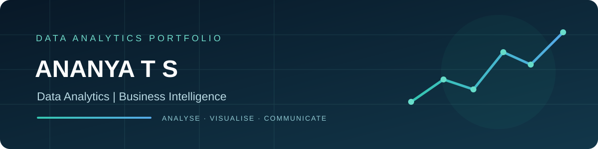

### DATA ANALYTICS · BUSINESS INTELLIGENCE · DATA VISUALISATION

*Finding the story behind the numbers.*

 

---

## Welcome, I'm Ananya!

I'm building my career in Data Analytics, with a growing interest in understanding data, finding meaningful patterns and turning information into something people can actually use.

My journey into analytics has been a learning experience in itself. Working with different tools and datasets has helped me understand that data analysis is not just about numbers or dashboards. It's also about asking the right questions, being patient with the details and communicating what the results mean.

I enjoy the process of taking a dataset, exploring what it contains and gradually turning it into a clearer picture. I'm still learning, experimenting and improving with every project, and that's what keeps me interested in this field.

📍 Kerala, India  
💻 Aspiring Data Analyst  
📊 Interested in Analytics and Business Intelligence

---

## Tools I Work With

**Currently exploring**

---

## My Analytics Journey

I completed Data Analytics training with ExcelR, where I had the opportunity to work with analytical tools and apply what I was learning through structured projects.

The experience helped me become more familiar with the different stages of analysis — from working with datasets and understanding their structure to building visualisations and presenting findings.

One thing I've come to appreciate is that learning a tool is only one part of becoming an analyst. Understanding the data, checking the details and explaining the outcome are equally important.

I'm now focused on strengthening these skills and building individual projects that reflect my own approach to solving analytical problems.

---

## What I Bring to a Project

**A structured approach to analysis**  
I like to understand the dataset and the objective before jumping into visualisations.

**Attention to detail**  
I value checking data, understanding inconsistencies and making sure the findings are meaningful.

**Visual communication**  
I enjoy presenting information through dashboards and clear visual explanations.

**A communication-focused perspective**  
My academic background in Functional English has made clear communication an area I value. I want my analysis to be understandable, not just technically correct.

---

## Featured Project

### Patient Healthcare Analytics

**A collaborative analytics project**

Tools: Excel · Tableau · MySQL

This project involved exploring a healthcare dataset containing patient, doctor, visit, treatment and laboratory information.

Working on this project gave me an opportunity to understand how different datasets can be explored, how key indicators can be presented and how analytical findings can be communicated through dashboards.

**Project highlights**
- Explored healthcare-related records and key indicators.
- Worked with Excel dashboards and PivotTables.
- Used Tableau to present data visually.
- Used MySQL queries for data checks and validation.
- Collaborated with team members throughout the project.

**What I learned**

The project helped me appreciate the importance of data consistency, clear KPI definitions and choosing visualisations that make information easier to understand.

---

## Currently Learning

I'm working on becoming more confident and independent with the tools used in data analytics.

- Improving SQL query writing and problem-solving.
- Developing Power BI skills, including data modelling and DAX.
- Practising dashboard design and data storytelling.
- Building a stronger foundation in Python for data analysis.
- Creating individual portfolio projects from scratch.

---

## Beyond the Numbers

I believe good analysis should make information easier to understand.

I'm interested not only in finding patterns, but also in understanding why they matter and how to communicate them clearly.

For me, every project is an opportunity to learn something new, improve my approach and become a more thoughtful analyst.

---

## Let's Connect

I'm always open to connecting with people who share an interest in analytics, business intelligence and continuous learning.

  

*Learning with curiosity. Analysing with purpose. Growing with every project.*

